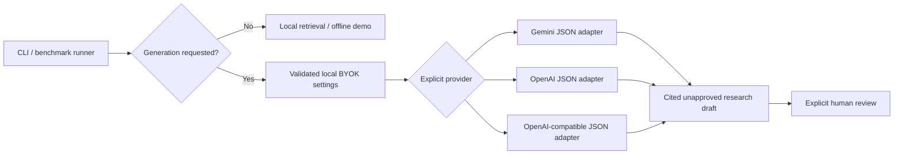

# Bring-your-own-key generation architecture

Draft implementation for the existing local research CLI and benchmark runner.
It adds Gemini, OpenAI, and explicit OpenAI-compatible endpoint selection without
changing research-result contracts or human approval gates.



## Configuration

Copy `.env.example` to a private local `.env`, or inject environment variables
through your secret manager. `.env` stays ignored. Environment values win over
`.env`; no key is accepted through a CLI argument, committed configuration, or
review artifact. A shell-history-safe editor/secret manager is preferable to
putting the key directly in a shell command.

| Provider | Model setting | Default key variable | Endpoint |
|---|---|---|---|
| `gemini` (legacy default) | `RESEARCH_MODEL`, then `GOOGLE_MODEL`, then `gemini-2.5-flash` | `GOOGLE_API_KEY` | Gemini SDK default |
| `openai` | `RESEARCH_MODEL` required | `OPENAI_API_KEY` | Explicit `https://api.openai.com/v1` |
| `openai_compatible` | `RESEARCH_MODEL` required | `RESEARCH_API_KEY` | `RESEARCH_BASE_URL` required |

Set `RESEARCH_PROVIDER` to one row. `RESEARCH_API_KEY_ENV` optionally names a
provider-specific secret environment variable; it contains the variable name,
not the secret. Blank optional template settings preserve defaults. A provider
never borrows another provider's key or silently falls back to another provider.
Custom endpoints require HTTPS, except HTTP on `localhost`, `127.0.0.1`, or `::1`.
URL credentials, query strings, fragments and malformed ports are rejected.
The ordinary OpenAI path ignores ambient `OPENAI_BASE_URL`; endpoint redirection
requires explicit selection of the compatible provider.

Examples (key values are deliberately omitted):

```dotenv
RESEARCH_PROVIDER=openai
RESEARCH_MODEL=<your-accessible-JSON-capable-model>
# Supply OPENAI_API_KEY locally.
```

```dotenv
RESEARCH_PROVIDER=openai_compatible
RESEARCH_MODEL=<your-endpoint-model>
RESEARCH_BASE_URL=http://localhost:8080/v1
# Supply RESEARCH_API_KEY locally, even if the local endpoint uses a dummy key.
```

Run the unchanged CLI:

```sh
python main.py --query "What approaches improve reasoning efficiency in LLMs?" --mode summary
python -m evaluation.run_benchmarks --mode summary --output /tmp/new-byok-run
python main.py --demo --query "agents" --mode retrieval
```

Custom endpoints must implement Chat Completions, `response_format=json_object`,
and temperature zero. Unsupported models/endpoints fail visibly; there is no
silent relaxation to unstructured output. Compatibility is not a claim that every
OpenAI-compatible model supports this contract. Existing structural/citation-ID
checks remain necessary but do not establish factual support.

## Authority, privacy and execution boundaries

- Each installation/operator supplies its own key. The app does not provision
  accounts, proxy team credentials, persist keys in a database, or collect keys
  through a website. This is a **local BYOK architecture**, not hosted multi-user
  credential storage or tenancy.
- Only selecting generation loads dotenv/config/SDK and constructs a client;
  importing modules, retrieval and synthetic demos make no provider call.
- Selected generation sends the query and retrieved passages to that provider.
  BYOK does not make cloud generation offline. Choose only endpoints authorized
  to receive that material. No new provider is contacted by default.
- Gemini and OpenAI requests have a 60-second timeout and no automatic retry
  after the initial attempt. Provider errors are sanitized and chained details
  suppressed, with no key, prompt or raw response in user-facing errors.
- Provenance records provider/model/prompt/temperature and default-vs-custom
  endpoint kind, never keys or arbitrary endpoint URLs. A custom endpoint's
  identity must be recorded separately without secrets for reproducible runs.
- Generation stays `approved=false` and human review pending. The standalone
  Gemini Search-grounded regulatory checkpoint is unchanged; another provider's
  JSON output is not a substitute for that grounding or legal clearance.
- API billing/quota is controlled by the key owner. No budget manager, tenant
  isolation, streaming, credential rotation UI or provider health fallback is
  claimed. Production hosted key custody would require a separate design.

## Verification

`python -m unittest discover -s tests`: **93 offline tests pass** for this branch.
Seven BYOK tests cover legacy defaults, blank templates, key isolation, explicit
custom endpoints, safe provenance/errors, SDK request shapes, and no automatic
retry. SDK clients are mocked; no billable provider request, account setup, live
API compatibility or model-quality claim is made.
