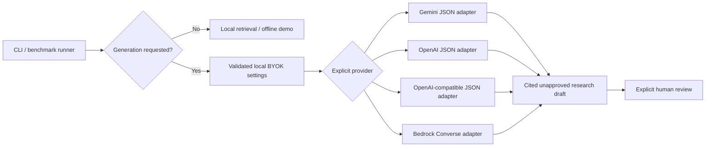

# Bring-your-own-key generation architecture

BYOK implementation for the existing local research CLI and benchmark runner.
It adds Gemini, OpenAI, explicit OpenAI-compatible endpoints, and native AWS
Bedrock Converse selection without changing research-result contracts or human
approval gates.



## Configuration

Copy `.env.example` to a private local `.env`, or inject environment variables
through your secret manager. `.env` stays ignored. Environment values win over
`.env`; no key is accepted through a CLI argument, committed configuration, or
review artifact. A shell-history-safe editor/secret manager is preferable to
putting the key directly in a shell command.

| Provider | Model setting | Default key variable | Endpoint |
|---|---|---|---|
| `gemini` (legacy default) | `RESEARCH_MODEL`, then `GOOGLE_MODEL`, then `gemini-2.5-flash` | `GOOGLE_API_KEY` | Gemini SDK default |
| `openai` | `RESEARCH_MODEL` required | `OPENAI_API_KEY` | Explicit `https://api.openai.com/v1` |
| `openai_compatible` | `RESEARCH_MODEL` required | `RESEARCH_API_KEY` | `RESEARCH_BASE_URL` required |
| `bedrock` | `RESEARCH_MODEL` required: Converse-compatible model/inference-profile ID or ARN | AWS SDK credential chain or `AWS_BEARER_TOKEN_BEDROCK` | AWS regional `bedrock-runtime` endpoint; explicit `AWS_REGION` or `AWS_DEFAULT_REGION` required |

Set `RESEARCH_PROVIDER` to one row. `RESEARCH_API_KEY_ENV` optionally names a
provider-specific secret environment variable; it contains the variable name,
not the secret. Blank optional template settings preserve defaults. A provider
never borrows another provider's key or silently falls back to another provider.
Custom endpoints require HTTPS, except HTTP on `localhost`, `127.0.0.1`, or `::1`.
URL credentials, query strings, fragments and malformed ports are rejected.
The ordinary OpenAI path ignores ambient `OPENAI_BASE_URL`; endpoint redirection
requires explicit selection of the compatible provider.
Bedrock does not read `RESEARCH_API_KEY` or another provider's key; a nonblank
`RESEARCH_API_KEY_ENV` is rejected for this provider. `AWS_REGION` wins over
`AWS_DEFAULT_REGION`, and a blank setting falls back to the latter. Bedrock
rejects `RESEARCH_BASE_URL` and ignores AWS SDK environment/shared-config endpoint
overrides so AWS authentication is sent only to the SDK's regional service endpoint.

Examples (key values are deliberately omitted):

```dotenv
RESEARCH_PROVIDER=openai
RESEARCH_MODEL=<your-accessible-JSON-capable-model>
# Supply OPENAI_API_KEY locally.
```

```dotenv
RESEARCH_PROVIDER=openai_compatible
RESEARCH_MODEL=<your-endpoint-model>
RESEARCH_BASE_URL=http://localhost:8080/v1
# Supply RESEARCH_API_KEY locally, even if the local endpoint uses a dummy key.
```

```dotenv
RESEARCH_PROVIDER=bedrock
RESEARCH_MODEL=<your-accessible-Converse-model-or-inference-profile>
AWS_REGION=us-east-1
# Supply AWS_BEARER_TOKEN_BEDROCK privately, OR use an existing AWS_PROFILE,
# IAM environment credentials/session token, or an authorized workload role.
# Leave RESEARCH_BASE_URL and RESEARCH_API_KEY_ENV blank.
```

The [Converse API](https://docs.aws.amazon.com/bedrock/latest/APIReference/API_runtime_Converse.html)
uses the AWS credential chain through `boto3` rather than OpenAI compatibility.
Existing local AWS profiles (including SSO), IAM credentials, session tokens and
workload roles are resolved by the SDK. Native
[Bedrock API keys](https://docs.aws.amazon.com/bedrock/latest/userguide/api-keys-use.html)
use `AWS_BEARER_TOKEN_BEDROCK`, not a research-provider key. Nothing provisions
an AWS account, role, key, model entitlement, or permission. The operator needs
access to the selected model/inference profile in the chosen region and appropriate
`bedrock:InvokeModel` permission. No live AWS compatibility is claimed.

Run the unchanged CLI:

```sh
python main.py --query "What approaches improve reasoning efficiency in LLMs?" --mode summary
python -m evaluation.run_benchmarks --mode summary --output /tmp/new-byok-run
python main.py --demo --query "agents" --mode retrieval
```

Custom endpoints must implement Chat Completions, `response_format=json_object`,
and temperature zero. Unsupported models/endpoints fail visibly; there is no
silent relaxation to unstructured output. Compatibility is not a claim that every
OpenAI-compatible model supports this contract. Existing structural/citation-ID
checks remain necessary but do not establish factual support.
For local endpoints, [model-sizing guidance](local-model-sizing.md) explains
parameter counts, quantization, working-memory/context requirements and the
measured small-model failures. The provider imposes no parameter-count ceiling.

For Bedrock, choose a model supporting Converse text messages and temperature
zero. JSON is **requested in the prompt and parsed/validated locally**, not
guaranteed by a provider-wide JSON-mode switch. The adapter rejects non-object or
nonfinite JSON, nontext content, tool calls, truncation, guardrail interventions,
and incomplete stop reasons instead of returning a partial draft or retrying.
Model-specific output schemas, reasoning configuration, streaming, and InvokeModel
request formats are not implemented. Claude through Bedrock can use this path
when the selected model/profile supports that request; it is not a direct Anthropic
API adapter, and it is not a claim that every Bedrock model is compatible.

## Authority, privacy and execution boundaries

- Each installation/operator supplies its own key or AWS identity. The app does not provision
  accounts, proxy team credentials, persist keys in a database, or collect keys
  through a website. This is a **local BYOK architecture**, not hosted multi-user
  credential storage or tenancy.
- Only selecting generation loads dotenv/config/SDK and constructs a client;
  importing modules, retrieval and synthetic demos make no provider call.
- Selected generation sends the query and retrieved passages to that provider.
  BYOK does not make cloud generation offline. Choose only endpoints authorized
  to receive that material. No new provider is contacted by default.
- Gemini and OpenAI requests have a 60-second timeout and no automatic retry
  after the initial attempt. Provider errors are sanitized and chained details
  suppressed, with no key, prompt or raw response in user-facing errors.
- Bedrock uses a 10-second connection timeout, 60-second read timeout and exactly
  one SDK inference attempt (`total_max_attempts=1`); it never falls back to another
  provider. This is not an absolute wall-clock limit on AWS credential resolution.
- Provenance records provider/model/prompt/temperature and default-vs-custom
  endpoint kind, never keys or arbitrary endpoint URLs. A custom endpoint's
  identity must be recorded separately without secrets for reproducible runs.
  Bedrock additionally records region and `json_mode=prompt_requested_and_validated`,
  never credentials, bearer tokens, profile names or credential-provider details.
- Generation stays `approved=false` and human review pending. The standalone
  Gemini Search-grounded regulatory checkpoint is unchanged; another provider's
  JSON output is not a substitute for that grounding or legal clearance.
- API billing/quota is controlled by the key owner. No budget manager, tenant
  isolation, streaming, credential rotation UI or provider health fallback is
  claimed. Production hosted key custody would require a separate design.

## Verification

`python -m unittest discover -s tests`: **103 offline tests pass** for this branch.
Seven BYOK tests cover legacy defaults, blank templates, key isolation, explicit
custom endpoints, safe provenance/errors, SDK request shapes, and no automatic
retry. Ten additional Bedrock tests cover region/model/native-auth validation,
credential isolation, real SDK Converse shapes through `Stubber`, real bearer-token
and IAM/SigV4 session signing with HTTP transport intercepted, ignored endpoint overrides, timeouts/retry
settings, JSON/completion errors, sanitized failures, provenance, and lazy imports.
SDK clients are mocked or stubbed and HTTP transport is intercepted; no billable
provider request, account setup, live API compatibility or model-quality claim is
made. The real AWS SDK checks used boto3/botocore `1.43.112`.
